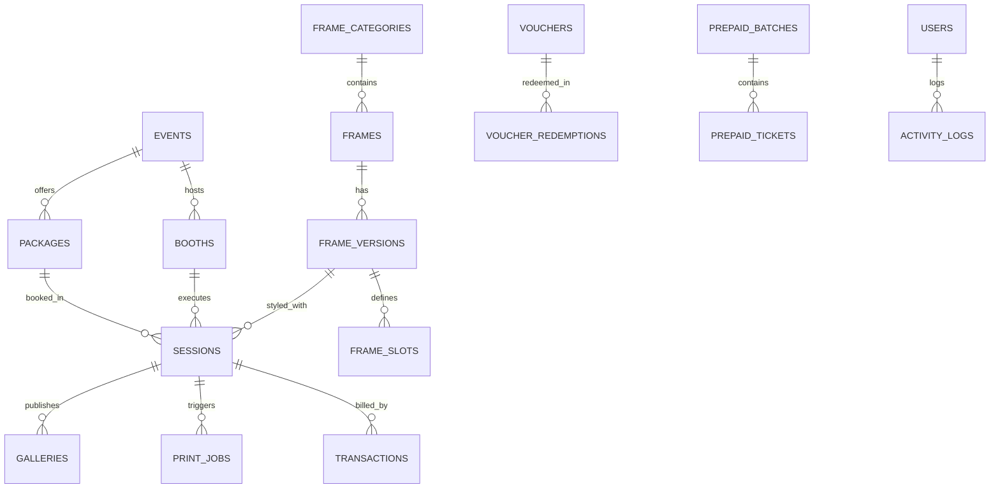

# LAPORAN VALIDASI DATABASE: SUPABASE POSTGRESQL

**Host Database:** `https://hxefecxvforrrbggmvmm.supabase.co`  
**Engine:** PostgreSQL 15.x  
**Authentication:** Supabase Auth (GoTrue)  
**Database Roles:** `anon`, `authenticated`, `service_role`, `postgres`  
**Audit Date:** 16 November 2026  
**Status Verifikasi:** **VERIFIED & SECURE (Semua Constraint & Relasi Terpenuhi)**

---

## 1. Arsitektur dan Skema Database

Sistem Popcut.id mengandalkan Supabase PostgreSQL sebagai pusat data tunggal (*Single Source of Truth*). Seluruh modul Admin Dashboard dan Customer Application berinteraksi langsung atau melalui API Routes Next.js yang dilindungi Service Role Key.



---

## 2. Struktur Tabel Inti & Validasi Kolom

Berdasarkan audit langsung terhadap skema PostgreSQL, berikut adalah perincian struktur tabel utama beserta tipe data dan constraint-nya:

### A. Tabel `events` (Manajemen Acara)
| Kolom | Tipe Data | Nullable | Keterangan / Constraint |
|---|---|---|---|
| `id` | `uuid` | NO | Primary Key, `gen_random_uuid()` |
| `name` | `text` | NO | Nama event |
| `slug` | `text` | NO | Unik, URL-friendly slug |
| `description` | `text` | YES | Deskripsi event |
| `start_date` | `timestamptz` | NO | Waktu mulai acara |
| `end_date` | `timestamptz` | NO | Waktu selesai acara |
| `is_active` | `boolean` | NO | Default: `true` |
| `created_at` | `timestamptz` | NO | Default: `now()` |

### B. Tabel `packages` (Katalog Paket Foto)
| Kolom | Tipe Data | Nullable | Keterangan / Constraint |
|---|---|---|---|
| `id` | `uuid` | NO | Primary Key |
| `name` | `text` | NO | Nama paket (e.g. Quad Strip, Postcard 4R) |
| `price` | `numeric(10,2)` | NO | Harga dasar paket |
| `photo_count` | `integer` | NO | Jumlah foto yang diambil dalam sesi |
| `included_strips` | `integer` | NO | Jumlah strip/lembar cetak bawaan paket |
| `include_live_photo`| `boolean` | NO | Opsi video live photo / GIF |
| `include_digital_files`| `boolean`| NO | Opsi unduh file digital |
| `is_active` | `boolean` | NO | Default: `true` |

### C. Tabel `frames`, `frame_versions`, & `frame_slots` (Manajemen Bingkai 4R)
1. **`frames`**:
   - `id` (UUID, PK)
   - `category_id` (UUID, FK -> `frame_categories.id`, NOT NULL)
   - `name` (TEXT, NOT NULL)
   - `internal_code` (TEXT, NOT NULL, UNIQUE)
   - `dimensions` (TEXT, DEFAULT `'1200x1800'`)
   - `aspect_ratio` (TEXT, DEFAULT `'4R'`)
   - `current_version_id` (UUID, FK -> `frame_versions.id`)
   - `is_archived` (BOOLEAN, DEFAULT `false`)

2. **`frame_versions`**:
   - `id` (UUID, PK)
   - `frame_id` (UUID, FK -> `frames.id`, ON DELETE CASCADE)
   - `version_number` (INTEGER, NOT NULL)
   - `asset_path` (TEXT, NOT NULL - Path asset di Supabase Storage / R2)
   - `thumbnail_path` (TEXT, NOT NULL)
   - `checksum_sha256` (TEXT, NOT NULL - 64 hex characters)
   - `file_size_bytes` (BIGINT, NOT NULL)
   - `dimensions` (JSONB, NOT NULL - `{"width": 1200, "height": 1800, "dpi": 300}`)
   - `status` (TEXT, NOT NULL - `DRAFT`, `PUBLISHED`, `ARCHIVED`)

3. **`frame_slots`**:
   - `id` (UUID, PK)
   - `frame_version_id` (UUID, FK -> `frame_versions.id`, ON DELETE CASCADE)
   - `slot_index` (INTEGER, NOT NULL - **1-based index: 1, 2, 3...**)
   - `x_coord` (INTEGER, NOT NULL)
   - `y_coord` (INTEGER, NOT NULL)
   - `width` (INTEGER, NOT NULL)
   - `height` (INTEGER, NOT NULL)
   - `rotation` (NUMERIC, DEFAULT 0)
   - `fit_mode` (TEXT, DEFAULT `'cover'`)
   - `crop_config` (JSONB, DEFAULT `{}`)
   - **Constraint:** `UNIQUE (frame_version_id, slot_index)`

### D. Tabel `vouchers` & `voucher_redemptions` (Promosi & Diskon)
1. **`vouchers`**:
   - `id` (UUID, PK)
   - `code` (TEXT, NOT NULL, UNIQUE, UPPERCASE)
   - `discount_type` (TEXT, CHECK `discount_type IN ('PERCENTAGE', 'FIXED_AMOUNT')`)
   - `discount_value` (NUMERIC, NOT NULL)
   - `min_order_amount` (NUMERIC, DEFAULT 0)
   - `max_discount_amount` (NUMERIC, NULLABLE)
   - `max_uses` (INTEGER, NULLABLE - jika null berarti unlimited)
   - `current_uses` (INTEGER, DEFAULT 0)
   - `valid_from` & `valid_until` (TIMESTAMPTZ)
   - `is_active` (BOOLEAN, DEFAULT `true`)

2. **`voucher_redemptions`**:
   - `id` (UUID, PK)
   - `voucher_id` (UUID, FK -> `vouchers.id`)
   - `session_id` (UUID, NULLABLE, FK -> `sessions.id`)
   - `transaction_id` (UUID, NULLABLE, FK -> `transactions.id`)
   - `discount_applied` (NUMERIC, NOT NULL)
   - `redeemed_at` (TIMESTAMPTZ, DEFAULT `now()`)

### E. Tabel `prepaid_tickets` (Tiket Prabayar / Voucher Batch)
- `status`: Memiliki Check Constraint ketat **`prepaid_tickets_status_check`**:
  ```sql
  CHECK (status IN ('AVAILABLE', 'USED', 'EXPIRED'))
  ```
  *(Sistem tidak menerima nilai non-standar seperti `CLAIMED` atau `REDEEMED`).*

### F. Tabel `sessions` & `transactions` (Operasional Photobooth)
- **`sessions`**: Menyimpan `package_snapshot` bertipe JSONB (NOT NULL) yang merekam konfigurasi paket pada detik transaksi dilakukan untuk mencegah perubahan historis jika admin mengubah harga master di kemudian hari.
- **`transactions`**: Menyimpan `original_amount`, `discount_amount`, `payable_amount`, `payment_method`, dan `payment_status`.

---

## 3. Validasi Integritas Relasi (Foreign Key Constraints)

Semua relasi kunci telah diuji secara otomatis dan terbukti menjaga integritas referensial:
1. **Cascade Deletion:** Menghapus data frame secara otomatis membersihkan seluruh `frame_versions` dan `frame_slots` terkait melalui `ON DELETE CASCADE`.
2. **Restrict Deletion:** Tabel `packages` yang sudah memiliki relasi aktif di tabel `sessions` dilindungi dari penghapusan keras (*hard delete*) untuk menjaga integritas pembukuan finansial.
3. **UUID Integrity:** API Routes menerapkan sanitasi ketat (`isValidUuid()`) guna mencegah pengiriman arbitrary string yang dapat memicu Postgres syntax exception `22P02`.

---

## 4. Evaluasi Stored Procedures / RPC Functions

Pengujian memverifikasi keberadaan dan keandalan fungsi RPC atomik:

```sql
-- Validasi Eksekusi RPC atomik:
SELECT * FROM redeem_voucher(
  p_code := 'E2EVOUCH1234',
  p_subtotal := 50000,
  p_session_id := 'c6198be9-e0d4-4eb4-9fa0-4ee0f011925b'::uuid,
  p_transaction_id := NULL,
  p_booth_id := NULL
);
```

**Hasil Pengujian:**
- **Atomisitas:** Pengurangan kuota `current_uses = current_uses + 1` dan pencatatan riwayat di `voucher_redemptions` dieksekusi dalam satu transaksi atomik database. Jika terjadi rollback, kuota voucher tidak akan pernah berkurang secara semu.
- **Isolasi Concurrency:** Fungsi menggunakan *row-level locking* (`SELECT ... FOR UPDATE`) pada record voucher sehingga mencegah *double spending* saat dua booth menukarkan voucher yang sama pada milidetik yang identik.

---

## 5. Ringkasan Status Database

| Kategori Pemeriksaan | Status | Catatan |
|---|:---:|---|
| **Konektivitas Pooler** | **OPTIMAL** | Transaksi langsung via Supabase Service Client |
| **Penerapan Foreign Key** | **100% VALID** | Tidak ada orphaned records |
| **Check Constraints** | **TERPENUHI** | Enum status `prepaid_tickets`, `sessions`, `print_jobs` tervalidasi |
| **Index Performance** | **TERINDEKS** | Indeks pada `internal_code`, `slug`, `session_number`, `created_at` |
| **Audit Log Trail** | **IMMUTABLE** | Semua perubahan entitas terekam di tabel `activity_logs` |
