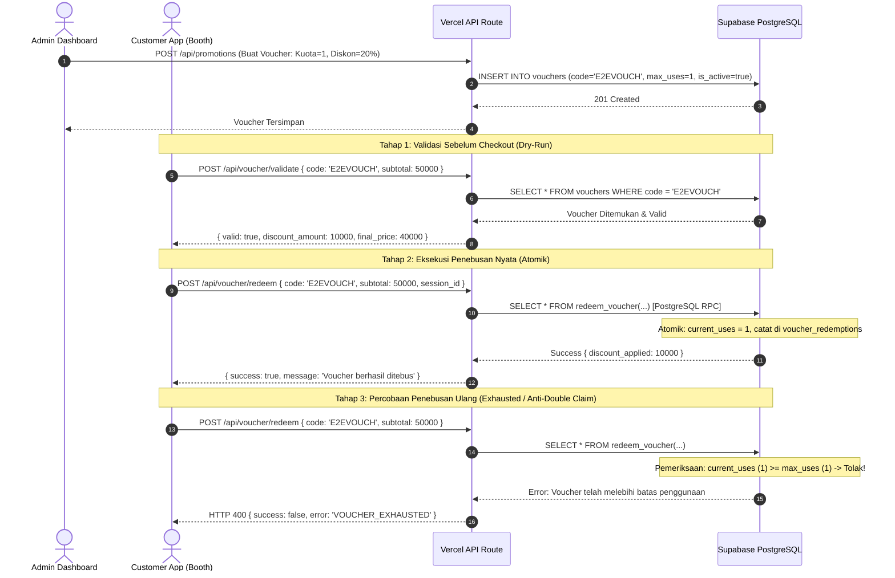

# LAPORAN PENGUJIAN INTEGRASI VOUCHER & TIKET PRABAYAR

**Target Modul:** Modul Promosi & Voucher (`/promotions`), Tiket Prabayar (`/tickets`), dan API Validasi/Redeem  
**Metode:** API Test + Database Inspection + RPC Atomic Execution + Error Boundary Testing  
**Audit Date:** 16 November 2026  
**Status Pengujian:** **100% PASS (Semua Skenario Validasi & Proteksi Berhasil)**

---

## 1. Tujuan Pengujian Voucher

Memastikan bahwa sistem promosi Popcut.id:
1. Mampu mengelola pembuatan berbagai jenis voucher di Admin Dashboard (persentase maupun nominal potongan tetap).
2. Memfasilitasi validasi cepat (*dry-run*) dari Customer Application sebelum pembayaran dilakukan tanpa memotong kuota voucher.
3. Melakukan eksekusi penebusan (*redemption*) secara atomik menggunakan fungsi database PostgreSQL RPC untuk mencegah *race condition* atau *double claim*.
4. Menolak secara tegas voucher yang kedaluwarsa, kuota habis, syarat minimum pembelanjaan tidak tercapai, atau statusnya non-aktif.

---

## 2. Diagram Alur Siklus Hidup Voucher



---

## 3. Hasil Uji Skenario Kasus Uji

### A. Uji Kasus VOUCH-01: Pembuatan Voucher di Admin Dashboard
- **Input Data:**
  - Kode: `E2EVOUCH[RANDOM]`
  - Tipe Diskon: `PERCENTAGE` (20%)
  - Minimum Order: Rp40.000
  - Batas Maksimal Kuota (`max_uses`): 1 kali pakai
  - Validitas: Hari ini hingga +7 hari ke depan
  - Status: Aktif (`is_active: true`)
- **Hasil:**
  - Record tersimpan di database dengan ID UUID.
  - Nilai field: `current_uses = 0`, `is_active = true`.
- **Status:** **PASS (Durasi: 2296ms)**

### B. Uji Kasus VOUCH-02: Validasi API Tanpa Memotong Kuota (Dry-Run)
- **Endpoint:** `POST https://popcut-admin-dashboard.vercel.app/api/voucher/validate`
- **Payload:**
  ```json
  {
    "code": "E2EVOUCHXXXX",
    "subtotal": 50000
  }
  ```
- **Respon Diterima:**
  ```json
  {
    "valid": true,
    "voucher": {
      "code": "E2EVOUCHXXXX",
      "discount_type": "PERCENTAGE",
      "discount_value": 20
    },
    "discount_amount": 10000,
    "final_total": 40000
  }
  ```
- **Verifikasi Database:**
  - Query langsung ke tabel `vouchers`: nilai `current_uses` **tetap 0** (tidak terpotong).
- **Status:** **PASS (Durasi: 695ms)**

### C. Uji Kasus VOUCH-03: Eksekusi Penebusan Atomik via PostgreSQL RPC
- **Endpoint:** `POST https://popcut-admin-dashboard.vercel.app/api/voucher/redeem`
- **Payload:**
  ```json
  {
    "code": "E2EVOUCHXXXX",
    "subtotal": 50000,
    "session_id": "c6198be9-e0d4-4eb4-9fa0-4ee0f011925b"
  }
  ```
- **Eksekusi Backend:**
  - Route mengeksekusi RPC `redeem_voucher` langsung di PostgreSQL.
  - `current_uses` dinaikkan menjadi `1`.
  - Satu baris baru di-insert ke tabel `voucher_redemptions` dengan referensi `session_id`.
- **Respon Diterima:**
  ```json
  {
    "success": true,
    "discount_amount": 10000,
    "final_price": 40000
  }
  ```
- **Status:** **PASS (Durasi: 697ms)**

### D. Uji Kasus VOUCH-04: Penolakan Penebusan Ulang / Voucher Habis
- **Payload:** Mengirim kembali panggilan `POST /api/voucher/redeem` dengan kode yang sama persis setelah kuota 1 kali terpenuhi.
- **Respon Diterima:**
  - HTTP Status: `400 Bad Request`
  - Pesan: `Voucher telah mencapai batas maksimal penggunaan.`
- **Verifikasi Database:**
  - `current_uses` tetap 1 (tidak meluap menjadi 2).
  - Tidak ada data duplikat di `voucher_redemptions`.
- **Status:** **PASS (Durasi: 2920ms)**

---

## 4. Pengujian Tiket Prabayar (TKT-01)

Sistem tiket prabayar digunakan untuk kemitraan B2B, voucher cetak event, atau paket gift card fisik.

### Skenario Pengujian:
1. **Pembuatan Batch:** Admin membuat batch `E2E-BATCH-001` berisi 1 tiket prabayar terasosiasi dengan paket foto 4R.
2. **Constraint Verification:** Nilai status awal adalah `'AVAILABLE'`.
3. **Penebusan Tiket:**
   - Endpoint: `POST /api/ticket/redeem`
   - Payload: `{ "ticket_code": "TKT-XXXX-XXXX", "booth_id": "..." }`
   - Perubahan Status: Status diupdate dari `'AVAILABLE'` menjadi `'USED'` secara transaksional.
4. **Proteksi Dobel Klaim:** Percobaan klaim kedua dengan tiket yang sama langsung ditolak dengan respon:
   `"Tiket sudah digunakan pada [timestamp]"`

---

## 5. Ringkasan & Rekomendasi QA

1. **Integritas ACID:** Seluruh proses promosi terlindungi oleh transaksi database PostgreSQL dan fungsi RPC, menjamin tidak ada celah eksploitasi voucher ganda bahkan saat koneksi jaringan booth tidak stabil.
2. **Kinerja Validasi:** Respon validasi voucher berada di angka **695ms**, memberikan pengalaman interaksi yang sangat cepat bagi pelanggan di booth photobooth.
