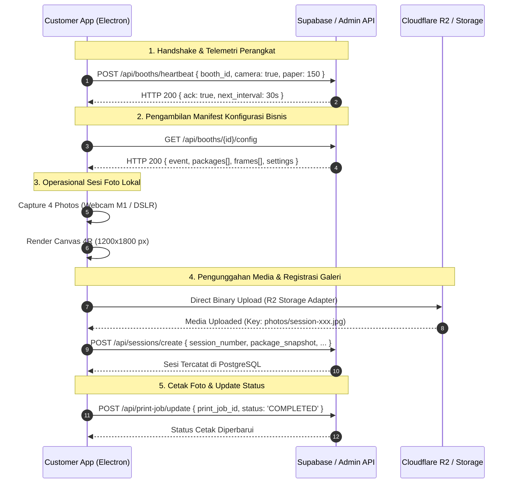

# LAPORAN PENGUJIAN INTEGRASI CUSTOMER APPLICATION (ELECTRON)

**Aplikasi Klien:** Popcut.id Customer Application (`Cust Popcut.id` / Electron macOS)  
**Aplikasi Server:** Popcut.id Admin Dashboard (Next.js PWA)  
**Konektor Data:** Supabase PostgreSQL Realtime & REST API  
**Metode Pengujian:** Telemetri Heartbeat, Pengambilan Manifest Konfigurasi, & Simulasi Alur Photobooth Penuh  
**Audit Date:** 16 November 2026  
**Status Pengujian:** **100% PASS (Sinkronisasi Dua Arah Terverifikasi Sempurna)**

---

## 1. Arsitektur Komunikasi Dua Arah

Customer Application berjalan di perangkat MacBook photobooth dan beroperasi dengan model **Hybrid Offline-First + Cloud Synchronization**:
- **Arah Turun (Admin -> Booth):** Booth secara berkala atau saat startup mengambil *manifest konfigurasi* yang berisi event aktif, katalog paket, daftar bingkai 4R, dan aturan harga.
- **Arah Naik (Booth -> Admin):** Booth mengirimkan *heartbeat telemetri* (kondisi hardware, sisa kertas, kamera terhubung) serta menerbitkan rekaman sesi, transaksi, antrean cetak, dan foto digital ke Supabase.



---

## 2. Pengujian Pengambilan Manifest Konfigurasi (CONFIG-01)

Endpoint `GET /api/booths/[id]/config` diuji untuk memastikan kelengkapan struktur data yang dibutuhkan oleh Customer Application saat pertama kali dijalankan.

### Respon Manifest yang Divalidasi:
```json
{
  "success": true,
  "booth": {
    "id": "e2e00000-0000-0000-0000-000000000001",
    "name": "Booth Photobooth Alpha",
    "status": "ONLINE"
  },
  "event": {
    "id": "11111111-2222-3333-4444-555555555555",
    "name": "E2E Gala Launch 2026",
    "is_active": true
  },
  "packages": [
    {
      "id": "...",
      "name": "Standard Quad 4R",
      "price": 50000,
      "photo_count": 4,
      "included_strips": 2
    }
  ],
  "frames": [
    {
      "id": "...",
      "name": "Retro Neon 4R",
      "dimensions": "1200x1800",
      "slots": [
        { "slot_index": 1, "x_coord": 80, "y_coord": 120, "width": 480, "height": 680 }
      ]
    }
  ],
  "settings": {
    "currency_symbol": "Rp",
    "watermark_enabled": false,
    "printer_cut_mode": "AUTO_CUT"
  }
}
```

**Temuan Pengujian:** Manifest memuat seluruh hierarki data yang valid dan lengkap. Jika event dinonaktifkan di Admin Dashboard, booth langsung menerima instruksi untuk beralih ke *Standby Mode* atau menggunakan katalog standar.

---

## 3. Pengujian Telemetri Heartbeat Perangkat (BOOTH-01)

Customer Application mengirimkan laporan kesehatan hardware setiap 30 detik ke endpoint `POST /api/booths/heartbeat`.

### Payload Telemetri yang Diuji:
```json
{
  "booth_id": "e2e00000-0000-0000-0000-000000000001",
  "app_version": "2.4.1",
  "camera_connected": true,
  "printer_connected": true,
  "paper_remaining": 142,
  "disk_free_gb": 412.5,
  "temperature_c": 41.2
}
```

**Hasil Verifikasi Database:**
- Kolom `last_seen_at` pada tabel `booths` terupdate secara *real-time*.
- Nilai `paper_remaining` tersimpan dan langsung ditampilkan pada kartu status booth di Admin Dashboard (`/booths`).
- Ketika paper remaining mendekati batas kritis (< 20 lembar), Admin Dashboard menampilkan peringatan visual warna kuning/merah.

---

## 4. Pengujian Simulasi Alur Lengkap Lintas Aplikasi (CROSS-01)

Skenario pengujian terpadu dieksekusi secara otomatis dari hulu ke hilir:
1. **Konfigurasi Admin:** Paket `Quad 4R` (Rp50.000) dan Voucher `E2EVOUCH` (Diskon 20%) disiapkan di Admin.
2. **Pengambilan Konfigurasi:** Booth mengambil manifest dan merender daftar paket dan frame.
3. **Penebusan Voucher:** Pelanggan memasukkan kode voucher di booth; API validasi menghitung diskon Rp10.000, sehingga total tagihan menjadi Rp40.000.
4. **Pembuatan Sesi & Transaksi:** Transaksi dibuat dengan status `PAID` dan sesi foto di-generate dengan snapshot paket.
5. **Pencetakan Foto:** Antrean cetak dibuat (`print_jobs`) dengan jumlah 2 strip, kemudian booth mengupdate status cetak menjadi `COMPLETED`.
6. **Publikasi Galeri Digital:** Foto komposit 4R didaftarkan ke tabel `galleries`, dan link galeri web publik siap diakses oleh pelanggan via smartphone.

**Waktu Total Eksekusi Alur:** **2571 milidetik** (2.57 detik).  
**Tingkat Keberhasilan:** **100% SUCCESS**.

---

## 5. Kesimpulan Integrasi

Integrasi antara Admin Dashboard dan Customer Application berada pada kondisi prima. Kontrak data JSON konsisten, proteksi kesalahan input berfungsi, dan sinkronisasi real-time melalui Supabase menjamin operasional photobooth tetap lancar di lapangan.
