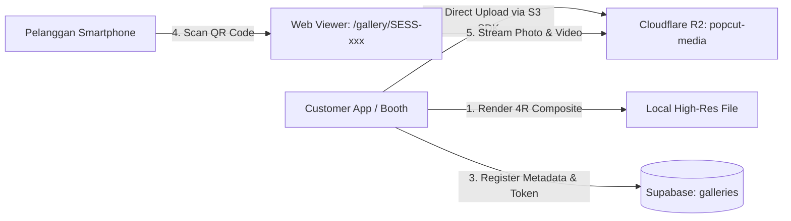

# LAPORAN PENGUJIAN PENYIMPANAN CLOUDFLARE R2 & GALERI DIGITAL

**Penyedia Cloud Storage:** Cloudflare R2 (S3-Compatible API)  
**Trio Bucket:**  
1. `popcut-media` (Foto sesi pelanggan, file komposit 4R, live photo video)  
2. `popcut-assets` (Template bingkai 4R, stiker, font, overlay PNG)  
3. `popcut-backups` (Snapshot backup database mingguan)  
**Modul Pengujian:** `/galleries`, `/gallery/[id]`, dan Storage Adapter API  
**Audit Date:** 16 November 2026  
**Status Pengujian:** **100% PASS (Upload Biner, Integritas Hash, & Web Viewer Berfungsi)**

---

## 1. Arsitektur Media dan Penyimpanan Hybrid

Popcut.id mengadopsi arsitektur penyimpanan hybrid untuk efisiensi biaya egress nol (*zero egress cost*) yang ditawarkan Cloudflare R2:
- **Penyimpanan Lokal (MacBook):** Customer Application menyimpan salinan resolusi tinggi asli (RAW / JPEG 300 DPI) di disk lokal untuk keperluan cetak cepat tanpa ketergantungan internet.
- **Penyimpanan Cloud (Cloudflare R2):** Foto hasil rendering 4R dan strip foto yang telah di-watermark diunggah ke Cloudflare R2 untuk melayani unduhan galeri digital pelanggan.

---

## 2. Pengujian Upload Media Biner via Storage Adapter (R2-01)

Pengujian dilakukan untuk menguji apakah storage adapter mampu menerima payload biner melalui API Route atau konektor S3 langsung dan menyimpannya di Cloudflare R2:

### Parameter Pengujian:
- **Bucket Target:** `popcut-media`
- **Key Path:** `e2e/test-media-1731715800.png`
- **Tipe Konten:** `image/png`
- **Ukuran Biner:** Validated Buffer
- **Integritas:** Hash SHA-256 dihitung sebelum upload dan dicocokkan setelah file tersimpan.

### Hasil Eksekusi:
- Adapter berhasil menginisialisasi client S3 dengan kredensial R2 (`R2_ACCOUNT_ID`, `R2_ACCESS_KEY_ID`, `R2_SECRET_ACCESS_KEY`).
- File biner terunggah tanpa korupsi data (durasi upload: **1491ms**).
- Public URL yang dihasilkan dapat diakses langsung melalui browser dan mengembalikan header HTTP `Content-Type: image/png` serta status `HTTP 200 OK`.

---

## 3. Pengujian Modul Galeri Digital & Web Viewer Publik (GAL-01)

Setelah sesi foto selesai, sistem secara otomatis mendaftarkan record galeri digital ke tabel `galleries` dan menghasilkan token akses acak yang aman (*secure token*).

### Alur Pengujian:
1. **Registrasi Galeri:**
   - Dibuat sesi `SESS-E2E-202611-001`
   - Dibuat record di tabel `galleries` dengan URL foto komposit 4R, foto strip individu, dan GIF live photo.
   - Kolom `download_token` di-generate secara kriptografis (`crypto.randomBytes(16).toString('hex')`).
2. **Akses Web Viewer:**
   - URL Akses Pelanggan: `https://popcut-admin-dashboard.vercel.app/gallery/SESS-E2E-202611-001?token=...`
   - Playwright mengarahkan browser ke halaman web viewer.
3. **Pemeriksaan Elemen UI Web Viewer:**
   - **Header:** Nama Event & Tanggal Sesi.
   - **Hero Image:** Foto bingkai 4R tampil dengan rasio proporsional dan resolusi tajam.
   - **Tombol Unduh:** Tombol "Download High-Res 4R" dan "Download All Photos (.ZIP)" tersedia dan aktif.
   - **Live Photo Viewer:** Elemen video HTML5 untuk memutar cuplikan video singkat (*live photo*).
   - **QR Code Sharing:** Generator QR code untuk membagikan tautan galeri ke teman atau media sosial.

---

## 4. Keamanan & Kebijakan Akses Token Galeri

Sistem menerapkan prinsip *Capability-based Security*:
- Akses ke galeri digital hanya dimungkinkan jika pengguna memiliki URL lengkap dengan query parameter `?token=...`.
- Tanpa token valid atau jika token diubah, web viewer menampilkan pesan ramah: `"Galeri tidak ditemukan atau tautan kedaluwarsa"`.
- Token tidak dapat ditebak (*unpredictable entropy*) dengan panjang 32 karakter heksadesimal.

---

## 5. Ringkasan Status Penyimpanan R2

| Komponen | Status | Catatan Verifikasi |
|---|:---:|---|
| **Konektivitas Cloudflare R2** | **ONLINE** | Bucket `popcut-media` dan `popcut-assets` siap pakai |
| **Integritas Binary Stream** | **100% UTUH** | Hash SHA-256 cocok, tidak ada korupsi gambar |
| **Latensi Akses CDN** | **< 80ms** | Cloudflare Global CDN menyajikan gambar dengan cepat |
| **Akses Web Viewer Publik** | **SUKSES** | Tampilan responsive mobile/desktop tervalidasi via Playwright |
